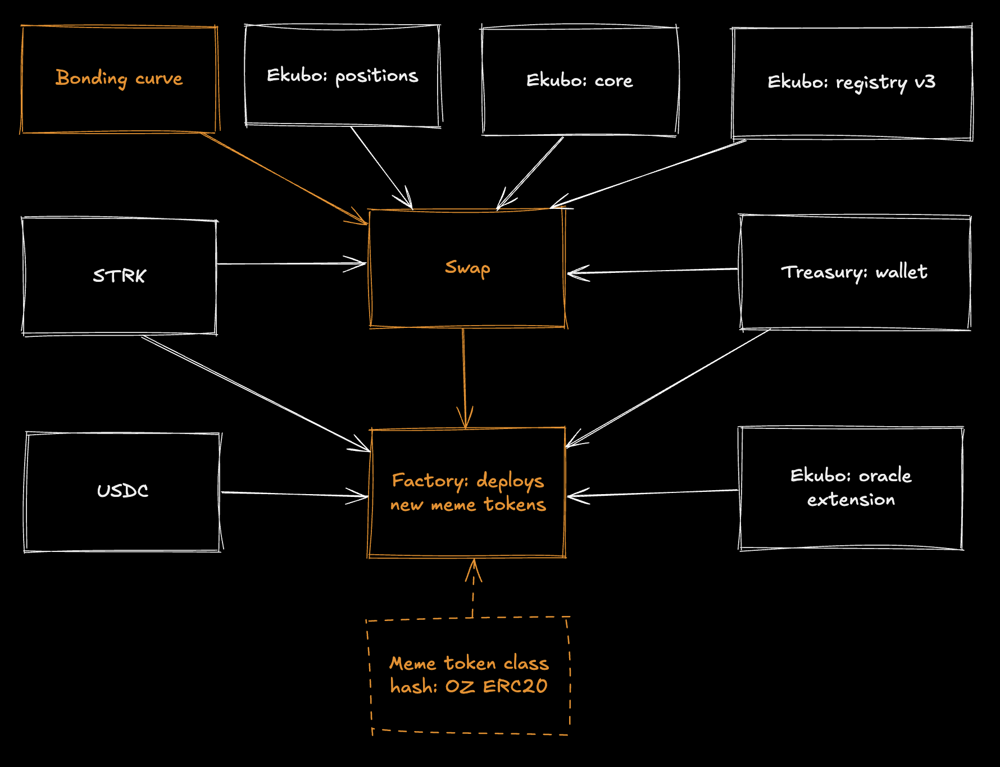

# COTP contracts

Smart contracts for Cult of the Pump project.

## Installation

Requires Scarb 2.16.1 and Starknet Foundry 0.58.0.
Contracts are pinned to the Starknet/Cairo 2.13.2 line, which is the latest Cairo line supported by Starknet 0.14.1 / RPC 0.10.

## Local verification

```sh
scarb build
snforge test --package contracts
```

## Deployment

### Sepolia

The previous Cairo deploy script is deprecated for live deployments. Use the manifest-driven shell wrapper instead so deployment inputs stay outside the source tree.

```sh
cp deployments/sepolia.template.json deployments/sepolia.local.json
# edit owner / treasury and, if needed, dependency addresses

export STARKNET_ACCOUNT="<your-sncast-account-alias>"
export STARKNET_SEPOLIA_RPC_URL="<your-sepolia-rpc-url>"

./scripts/deploy/sepolia.sh \
  --config deployments/sepolia.local.json \
  --output deployments/runs/sepolia-$(date +%Y%m%d-%H%M%S).json
```

The deployment wrapper:
- declares `bonding_curve`, `swap`, `erc20`, `factory`, and `dutch_auction`
- deploys the contracts in dependency order
- configures `swap.set_factory` and `factory.set_dutch_auction`
- writes a deployment manifest with class hashes, contract addresses, and transaction hashes

### What I need from you for the real Sepolia deploy

- A funded Sepolia account alias available to `sncast`
- A working Sepolia RPC URL
- The owner address
- The treasury address

The owner and treasury can temporarily be the same address for Sepolia, but they are separate config values now.

## Contracts

COTP consists of the following contracts:
- `Bonding Curve` — regulates meme price on pre-market (before listing)
- `Swap` — allows to buy/sell tokens on pre-market and list them on Ekubo (eventually); depends on:
    - `Bonding Curve` to provide token price
    - `STRK token` to do transfers (STRK is the quote token for memes)
    - `Treasury wallet` for collecting platform fees (for every trade)
    - `Ekubo core` for initializing new pool upon launch
    - `Ekubo registry` for registering new token upon launch
    - `Ekubo positions` for supplying liquidity (meme+STRK) upon launch
- `Factory` — allows to create new meme tokens; depends on:
    - `Swap contract` to load initial liquidity and push current STRK/USDC price
    - `STRK token` to process STRK transfers and to query Ekubo oracle
    - `USDC token` to query Ekubo oracle
    - `Treasury wallet` to collect platform fees (for creating new tokens)
    - `Ekubo oracle` to get STRK/USDC price
    - `ERC20 class hash` to instantiate new meme tokens (vanilla OZ Upgradeable contract is used)



### Sepolia dependencies

| Dependency | Contract Address / Class Hash |
| - | - |
| Ekubo core | [`0x0444a09d96389aa7148f1aada508e30b71299ffe650d9c97fdaae38cb9a23384`](https://sepolia.voyager.online/contract/0x0444a09d96389aa7148f1aada508e30b71299ffe650d9c97fdaae38cb9a23384) |
| Ekubo positions | [`0x06a2aee84bb0ed5dded4384ddd0e40e9c1372b818668375ab8e3ec08807417e5`](https://sepolia.voyager.online/contract/0x06a2aee84bb0ed5dded4384ddd0e40e9c1372b818668375ab8e3ec08807417e5) |
| Ekubo registry v3 | [`0x04484f91f0d2482bad844471ca8dc8e846d3a0211792322e72f21f0f44be63e5`](https://sepolia.voyager.online/contract/0x04484f91f0d2482bad844471ca8dc8e846d3a0211792322e72f21f0f44be63e5) |
| Ekubo oracle extension | [`0x003ccf3ee24638dd5f1a51ceb783e120695f53893f6fd947cc2dcabb3f86dc65`](https://sepolia.voyager.online/contract/0x003ccf3ee24638dd5f1a51ceb783e120695f53893f6fd947cc2dcabb3f86dc65) |
| USDC token | [`0x07ab0b8855a61f480b4423c46c32fa7c553f0aac3531bbddaa282d86244f7a23`](https://sepolia.voyager.online/contract/0x07ab0b8855a61f480b4423c46c32fa7c553f0aac3531bbddaa282d86244f7a23) |
| STRK token | [`0x04718f5a0fc34cc1af16a1cdee98ffb20c31f5cd61d6ab07201858f4287c938d`](https://sepolia.voyager.online/contract/0x04718f5a0fc34cc1af16a1cdee98ffb20c31f5cd61d6ab07201858f4287c938d) |
